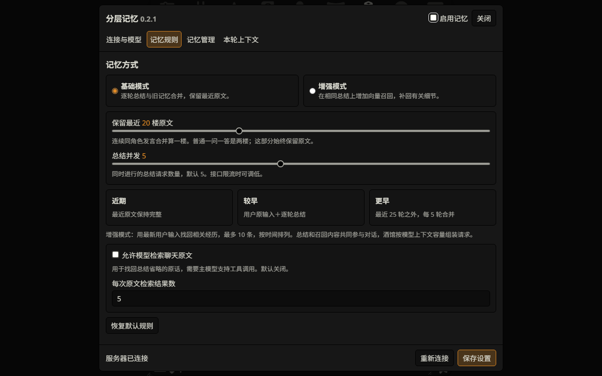

# 分层记忆

独立 SillyTavern 扩展，当前源码版本为 **0.2.3**。酒馆前端负责设置、交付聊天及注入记忆；酒馆服务器插件负责总结、合并、索引、检索和持久任务。记忆处理采用两级总结流程，设置界面参考 Anima 的前后端分工。

0.2.3 让长聊天不再拖慢发送，并理顺了改名、删改消息、恢复备份这些操作下的记忆：开着记忆时每条消息不再多存聊天，只向后端交付有变化的消息；聊天改名后记忆跟着走；删改一轮只重做它所在的合并记忆。最新两轮先不整理，重新生成、续写和预设脚本的改写不再让同一轮反复重做；总结按消息发给模型时的样子来写，角色卡和预设用正则去掉的状态栏、选项不再进总结；增强模式可以再接一个重排模型。

69 项自动测试通过，并在隔离的 SillyTavern 1.19.0 中用模拟模型实测：一套是干净环境下的发送、补录和各种删改操作，另一套照着真实使用搭——带大量正则和常驻脚本的预设、角色卡正则、Gemini 抗截断和输入混淆扩展、三段 850–1350 条消息的长聊天。完整行为见 [SPEC.md](SPEC.md)，验证范围与限制见 [ACCEPTANCE.md](ACCEPTANCE.md)。下方截图来自 0.2.2；0.2.3 的界面只在“连接与模型”页多了一栏重排模型，“记忆管理”页少了“确认最后回复完整”按钮。



## 安装

安装流程参考 [Anima 使用说明](https://gcn02iwpisfi.feishu.cn/wiki/Ga4uwBXpaimRfrkQnMtcbKvGnVd)：**前端在酒馆界面安装，后端在运行酒馆的服务器上安装，两部分都要装。** 本项目两部分共用同一个仓库，各安装一份；后端随酒馆进程启动。

需要 SillyTavern **1.19.0**（本版验证基准）、Git 和 Node **22.13 以上**。本次自动测试使用 Node 24.21.0。版本要求针对运行酒馆的服务器；远程使用时，手机或浏览器所在的电脑无需安装 Node。

### 1. 安装服务器插件

先停止酒馆，在服务器的 **SillyTavern 根目录**（有 `config.yaml`、`server.js` 的目录）打开终端，运行：

```sh
git clone https://github.com/ShirahaTobisa/ST-Layered-Memory.git plugins/ST-Layered-Memory
npm --prefix plugins/ST-Layered-Memory ci --omit=dev
```

Windows、Linux 和 Termux 都使用上述命令。Docker 用户应在实际运行酒馆的环境中执行，并确保插件目录随容器持久保存。

编辑酒馆的 `config.yaml`，将已有的对应项改为以下值，不要重复添加同名项：

```yaml
enableServerPlugins: true
enableServerPluginsAutoUpdate: false
```

第二项关闭后端插件自动更新，方便前后端一起手动更新。然后重新启动酒馆。后端入口应位于 `plugins/ST-Layered-Memory/package.json`；无需另开端口、编译 SQLite 或启动独立数据库。Node 22 可能显示 SQLite 的 `ExperimentalWarning`，这条提示本身不表示安装失败。

### 2. 安装前端扩展

打开酒馆的“扩展程序 → 安装扩展程序”，粘贴仓库地址：

```text
https://github.com/ShirahaTobisa/ST-Layered-Memory
```

安装后刷新页面。前端会由酒馆放入当前用户或全局的扩展目录，无需再手动复制一份。**本版不需要酒馆助手或 Extras**，也不需要修改酒馆核心源码；服务器插件通过酒馆原生服务器插件接口运行。

### 3. 配置并启用

在“扩展程序 → 分层记忆”填写总结模型的接口、模型名和 API Key，先用“基础模式”保存设置。打开聊天后勾选“启用记忆”；前端默认关闭。增强模式见下方“模型配置”。

若显示后端不可用，检查后端目录、依赖安装结果、`enableServerPlugins` 和酒馆启动日志，再点击面板中的重新连接按钮。仅安装前端不足以运行后台记忆任务，但不会阻塞聊天。

### 离线安装包

[v0.2.0 Release](https://github.com/ShirahaTobisa/ST-Layered-Memory/releases/tag/v0.2.0) 提供前端、服务器插件、SHA-256 和文件清单。将包内 `frontend/ST-Layered-Memory` 放入酒馆 `public/scripts/extensions/third-party/`，将 `server/ST-Layered-Memory` 放入 `plugins/`，然后按上面的步骤安装后端依赖、修改配置并重启。

离线安装不会自动获得 Git 更新；切换到仓库安装前，先停止酒馆，将旧前后端插件目录移出酒馆目录，再按上面的步骤安装。记忆数据库位于用户数据目录，无需删除。

## 更新

**前端和后端要一起更新。** 先停止生成，在酒馆扩展管理中更新“分层记忆”；完成后停止酒馆，在 SillyTavern 根目录运行：

```sh
git -C plugins/ST-Layered-Memory pull --ff-only
npm --prefix plugins/ST-Layered-Memory ci --omit=dev
```

重新启动酒馆，再刷新网页。只更新前端不会更新服务器插件；更新后端后也需要重新安装依赖。更新前的备份方式见下方“备份与卸载”。

从 0.2.x 升级不用迁移，前后端一起更新后，等待中的后台任务照常继续。从 0.1.0 升级会校验并迁移有效的逐轮与合并记忆，保留手动修改及启停状态。迁移前的记忆另存为数据目录中的 `memory.sqlite.v1-memory-backup.json`，不含模型密钥；无法匹配现有来源的旧记录也保存在这份副本里。旧版总结不会被偷偷重做，面板会提示哪些仍来自旧提示词，可自行备份后选择“重新整理全部”。

## 模型配置

总结、向量和重排各自单独配置。总结和向量是 **OpenAI 兼容接口**，填写 API 根地址，如 `https://example.com/v1`；Gemini 兼容地址可填 `https://generativelanguage.googleapis.com/v1beta/openai`。本版没有直接适配 Google 原生 `generateContent` 总结接口。

- 基础模式只需要总结模型，调用 `/chat/completions`。正文需非空，且接口不能明确报告长度截断、内容过滤或仍在工具调用阶段；失败时保留原文并标记任务失败。未提供结束原因的兼容接口仍可使用。一次总结最多等 3 分钟，带思考的模型常要一分多钟；超过就标记失败，可在“记忆”页重试。
- 总结模型可选“思考强度”（不指定、关闭、最低、低、中、高），以 `reasoning_effort` 随请求发出，不指定就不带这个参数。带思考的模型写一条总结可能想上万 token，一般选“低”就够；接口不认这个参数时保持不指定。
- 增强模式增加 `/embeddings`，索引内容是“用户原输入 + 逐轮总结”。查询使用最新用户输入，相似度至少 `0.48`，最多召回 10 条，再按原对话轮次放回。
- 重排模型可选，只在增强模式下、过了相似度门槛的候选多于 10 条时才调用：取相似度最高的 30 条交给它，按它的评分留下 10 条。接口是 `{API 地址}/rerank`，请求带 `model`、`query`、`documents`、`top_n`，返回 `results[].index` 和 `results[].relevance_score`（Jina、Cohere 等服务通用的格式）。不填就不用；调用失败时本次照旧按相似度取，并在“本轮上下文”里提示。
- API Key 保存到当前登录用户的后端数据库，不写到聊天、浏览器扩展设置或记忆导出。留空不会覆盖已保存密钥；勾选“清除已保存密钥”后保存才会清除。服务器磁盘中的密钥不是加密保险库，应沿用酒馆数据目录的访问权限和备份保护。

默认保留最近 20 个合并后的楼层，逐轮总结并发 5，最近 25 轮之外按每 5 轮进行合并，向量批量 16 条。这里没有独立的 2048 Token 记忆上限；酒馆仍负责最终上下文容量和 token 计数。

## 记忆与后台行为

连续同角色消息先合并为一个楼层；一个用户楼层及随后的角色楼层形成一轮，群聊保留发言人。开场白、待回复输入和系统消息不强行组成总结。每轮最多使用之前三轮作背景，目标只总结本轮。最近 25 轮之外，每五轮尝试合并；空轮可跳过，实际存在的逐轮总结才作为合并来源。

**最新两轮先不整理。** 最后一条回复还可能被重新生成、换候选或续写，再往前一条常被预设脚本在下一次发送时改写；这两轮本来就以原文发送，等后面又聊完两轮再总结，所以每发一句只调用一次总结。没写完、被取消或还在改的回复也因此不会被记入，不需要手动确认。已经有总结的轮次重新变成最新两轮时（比如删掉了后面几轮），原有总结保留。

**总结按消息发给模型时的样子来写。** 酒馆里只对提示词生效的正则（预设和角色卡用来去掉状态栏、变量更新、选项的那些）先处理过，再交给总结模型；聊天里存的原文不变，原文检索查的也是原文。改动正则不会让已有总结作废。

“记忆”页可交付聊天、停止、补录及重试、编辑和启停记忆、查看来源、导出、恢复及清空。没启用记忆、服务器上也没有记录的聊天不会被交付，先勾选“启用记忆”；启用过又关掉的聊天仍可查看和导出。后台任务交付成功后即可关闭页面；重启酒馆时会恢复已保存的待办。服务崩溃时，尚未保存结果的在途模型请求可能被重新请求，不承诺模型调用恰好一次。

编辑、换候选、删除或导入后，来源不符的总结不再参与上下文。删改一轮只重做它所在的那条合并记忆，其余合并记忆保留；连着删改几条时，等操作停下约 1.5 秒再交付，中间状态不会触发重算。新分支只从酒馆记录的直接父聊天复制来源完全匹配的逐轮及合并记忆，保留手动修改和启停状态；其他分支的修改不会混入，独立聊天不自动继承。聊天改名后记忆跟着走；复制或重新导入的聊天沿用原聊天里来源匹配的记忆；删除聊天会一并删掉它的记忆并停掉后台任务。之前三轮仅作总结背景，只有思考内容的轮次不作背景；单独改变背景不会使目标轮总结失效。不同登录用户的数据各自存储；不同角色、群组和聊天分别处理。重复交付同一内容不重新生成已有总结。

回复结束、编辑、删除、换候选之后等约 1.5 秒再交付，预设脚本紧跟着做的改写会并进同一次交付。禁用的逐轮记忆不会通过合并总结重新注入。

**酒馆的 hide 只隐藏原文，不删除或停用记忆。** 隐藏的对话仍参与总结和检索；基础与增强模式都会把有效总结放入发送历史，酒馆继续负责上下文容量。手动或其他脚本隐藏的消息，插件不会取消隐藏，也不会把隐藏原文重新发送。手动修改、记忆启停和已有索引在 hide/unhide 后保留；真正的系统通知、注释和工具中间消息仍排除。若旧版已经删掉总结，只能重新生成，或取消隐藏并同步到备份对应的聊天版本后恢复备份；手动修改无法凭空找回。

正常使用不需要为了节省上下文再手动 hide。默认最近 20 楼（普通一问一答约 10 轮）保留原文，更早的角色回复以逐轮总结替换；最近 25 轮之外，每完整 5 轮再用合并总结替换。25 轮是合并门槛，不是硬性丢弃旧消息的界线；总结未就绪、失败或来源无法确认时保留原文。

**已总结的旧楼自动隐藏**（记忆规则页，默认开）：最近 20 楼（按楼号数，隐藏的也算）以外、所在轮已有生效记忆的楼层由插件隐藏，聊天里看到的就是发给模型的样子。插件只取消自己隐藏的楼层：开分支后落回最近 20 楼、删改使总结失效、调大保留楼数、关闭记忆或这个选项时自动放回。手动或其他脚本隐藏的楼层不动；插件隐藏后被手动放出来的，以后不再隐藏。生成回复途中也照常处理：只动最近 20 楼以外的旧楼、一次改完再保存，酒馆在开始生成时就选好了这次要发的消息，正在生成的回复不受影响。隐藏不改变总结来源，不会引起重新总结。

角色卡或预设用正则把较远的楼层在提示词里清空时（常见的“不发送远楼层”写法），被清空的回复不管在不在最近 20 楼以内都换成它的总结，不留空档；总结还没做出来的保持原样。

总结、向量材料、手动编辑、备份恢复和原文检索共用思考过滤，支持常见标签的属性、嵌套和未闭合形式。升级时会清理旧总结中的已识别标签并撤下相关向量；原聊天及来源快照保留原文。无标签或已被改写成事实的思考内容无法自动识别，需要自行编辑或重新整理。备份恢复会按当前来源重建关联，向量重新计算。

消息来源 UUID 保存在 `extra.layered_memory`（旧消息里的 `rph_memory` 自动沿用），聊天谱系和上次交付时的聊天名保存在聊天元数据；不会替换聊天正文。自动隐藏的楼层在同一处记 `autoHidden`，插件隐藏后被手动放出来的记 `keepVisible`。刚打开聊天的页面以读到的聊天文件为准，所以恢复备份、从别的设备同步过来的聊天文件可以直接接着用；之后同一页面接着自己的版本交付。另一个页面先交付了新内容时拒绝覆盖，刷新后即可继续。不要在多个旧页面中轮流保存同一份聊天。

打开聊天时，服务器里存的和页面读到的一样就什么都不上传，不一样才完整交付一次；之后只交付有变化的消息。正常完成的回复不另存聊天，记忆要写进消息的标记随酒馆自己的保存落盘。单次最多 20000 条、单条最多 200000 字符，并受酒馆自身 HTTP 请求大小限制。1000 轮（2000 条、约 2.8 MB）的聊天用模拟模型实测过，数字见 [ACCEPTANCE.md](ACCEPTANCE.md)；更长的聊天和真实模型下的耗时未验收。

## 主聊天与其他扩展

基础模式在发送给模型的副本中替换已有有效总结的旧回复；增强模式另找回相关细节。最近原文、缺总结、无法精确对应的消息、工具调用与多媒体来源受保护。不会因为“已排队”而删掉尚未总结的内容。

酒馆复制世界书扫描输入后，插件替换发送副本中的旧历史，再由酒馆计算上下文容量；最后在主请求中追加增强召回。世界书扫描仍使用原文。最近未替换的消息逐条保留酒馆的发言人、附件和工具信息，合并楼层只用于判断保留范围。无法唯一匹配的旧正文不替换。预设脚本在组装请求途中改写了某条消息时，那条消息保持原样，其余照常替换，历史只压缩一次。已和带大量正则与常驻脚本的预设、角色卡正则、Gemini 抗截断、Gemini 输入混淆一起实测（见 [ACCEPTANCE.md](ACCEPTANCE.md)）；其他记忆扩展没有同开测过，不建议同时启用多套历史压缩。

本版注入支持酒馆的 Chat Completion 主聊天，后台静默生成和 AI 帮答旁路；Text Completion 请求不做上下文替换。本版不负责生成图片描述。

“允许模型检索聊天原文”默认关闭。开启后注册 `layered_memory_search`，查询当前聊天已交付原文，返回原楼层和命中附近片段。仍需酒馆及模型本身支持工具调用；与关键词搜索总结不同，它可找出总结遗漏的原话。

可与独立 Gemini 抗截断插件共用，不需要额外操作：没写完或被取消的回复属于最新两轮，先不整理。对于留在聊天里、语义上没写完的正文，本版无法自动判断，过了最新两轮后按原样总结。带真实工具调用的轮次目前不记入。与 Gemini 输入混淆扩展共用时，增强召回跟着本轮原话一起放进工具结果，不留在普通用户消息里。

## 备份与卸载

数据库：`data/<酒馆用户>/layered-memory/memory.sqlite`，WAL 文件可能与其并存。完整备份请先停止酒馆再复制整个 `layered-memory` 目录，包含密钥和任务。界面导出的 JSON 仅含记忆与来源，不含模型配置、密钥和向量。

JSON 恢复只接受同一聊天里来源仍然对得上的逐轮和合并总结，有一条对不上就整份不导入；导出之后聊天又往下聊了、或备份是 0.2.2 导出的，都可以恢复。不会把陌生聊天的数据绑定到当前聊天。向量可以补录重建。

“启用记忆”按聊天保存，新聊天默认关闭；开关先写进聊天文件，再通知服务器。从 0.1.0 升级时，尚未单独设置的聊天沿用旧开关。关闭后停止本聊天任务并旁路后续注入；服务器断线时仍能关闭本地注入，并提示后台停止尚未确认。其他聊天已交付的任务仍可运行。完全停用请停止酒馆，移出前端与后端两个目录，再重启。历史正文保留，数据库不会随移除插件删除。清空记忆会停止当前聊天补录，不删除聊天原文；“补录及重试”可重新建立。

## 开发与来源

在完整源码目录运行 `npm ci`、`npm test`，精简安装包不包含开发测试。源码分为 `client/`、`server/` 和 `shared/`，数据库与任务代码不依赖浏览器；SQLite 使用 Node 内置接口。

设置界面的前后端分工参考 [anima-rag](https://github.com/Ellinav/anima-rag)。许可见 [NOTICE.md](NOTICE.md)，本项目使用 CC BY-NC 4.0。
